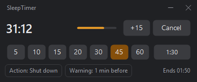
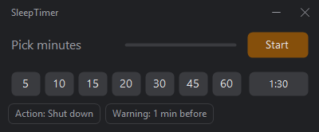
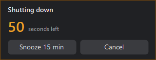

<div align="center">


# SleepTimer

**Pick a time. Fall asleep. The PC turns itself off.**

[](https://github.com/Aderimo/sleeptimer/releases/latest)
[](LICENSE)
[](#install)
[](#install)

### [⬇ Download SleepTimer.exe](https://github.com/Aderimo/sleeptimer/releases/latest)

**English** · [Türkçe](README.tr.md)



</div>

---

## Why

Falling asleep in front of a video leaves the PC running all night. Windows can already do
`shutdown /s /t 3600` — but typing that every night is a chore, there is no countdown, and
cancelling means another command.

SleepTimer is the same thing in a small window: one click to start, the time left always in
sight, one click to cancel.

## What it does

- **One-click times:** 5, 10, 15, 20, 30, 45 and 60 minutes — the countdown starts right away
- **Your own time:** type `90`, `1:30`, `2h`, `1.5h` or `45m` and press Enter
- **Live countdown** with a progress bar and the end time
- **+15** to snooze, **Cancel** to stop
- **One-minute warning** in the corner, with *Snooze 15 min* and *Cancel*. It doesn't steal focus,
  so a fullscreen video keeps playing. Can be turned off.
- **Shut down, sleep or hibernate**: pick what happens at the end
- **Runs in the tray** when minimised: hover the icon to see the time left, right-click for
  quick times
- **Safe after sleep:** if the time ran out while the PC was asleep, it doesn't shut down the
  moment you wake it




## Install

| | |
|---|---|
| OS | Windows 10 / 11 |
| .NET | Nothing to install. Uses .NET Framework 4.8, which ships with Windows |
| Internet | Not needed, ever |

1. Download **`SleepTimer.exe`** from [Releases](https://github.com/Aderimo/sleeptimer/releases/latest)
2. Double-click it

> **"Windows protected your PC"?** The exe isn't code-signed yet, so SmartScreen shows this for
> new apps. Click **More info → Run anyway**.

No installer. Keep the exe anywhere; to uninstall, delete it. Settings live in
`%APPDATA%\SleepTimer\ayarlar.txt`.

## How it shuts down

When the time is up, SleepTimer runs Windows' own `shutdown /s /t 0`. That's the same as
**Start → Power → Shut down**: apps are asked to close normally and nothing is forced. If a
document has unsaved changes, Windows may wait for it, just like it always does.

Sleep and hibernate use the standard Windows power calls.

## Light on your PC

- About **130 KB** on disk and around **20–25 MB** of memory
- While idle it does nothing; while counting it only redraws once a second
- No services, no startup entry, no network access, no telemetry

## Command line

```
SleepTimer.exe 45        start a 45-minute timer
SleepTimer.exe 1:30      start a 1 hour 30 minute timer
SleepTimer.exe --test    test mode: shows a message instead of shutting down
```

Opening it again while it's running brings the existing window to the front.

## Development

C# 5 / WinForms on .NET Framework 4.8, built with the `csc.exe` that comes with Windows,
so no SDK is needed.

```powershell
.\build.ps1          # dist\SleepTimer.exe
.\build.ps1 -Test    # build + automated tests + screenshots in obj\test\
```

The tests never shut the PC down; the power action is replaced with a test hook.

## License

[MIT](LICENSE)
