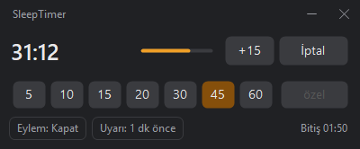
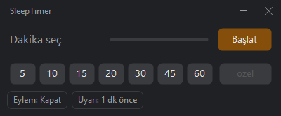
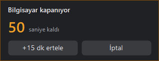

<div align="center">


# SleepTimer

**Süreyi seç. Uyuyakal. Bilgisayar kendini kapatsın.**

[](https://github.com/Aderimo/sleeptimer/releases/latest)
[](LICENSE)
[](#kurulum)
[](#kurulum)

### [⬇ SleepTimer.exe'yi indir](https://github.com/Aderimo/sleeptimer/releases/latest)

[English](README.md) · **Türkçe**



</div>

---

## Neden

Video izlerken uyuyakalınca bilgisayar bütün gece açık kalıyor. Windows bunu zaten
`shutdown /s /t 3600` ile yapabiliyor, ama her gece komut yazmak zahmetli, geri sayım
görünmüyor ve iptal etmek için yine komut gerekiyor.

SleepTimer aynı işi küçük bir pencerede yapar: başlatmak tek tık, kalan süre hep gözünün
önünde, iptal etmek de tek tık.

## Neler yapar

- **Tek tıkla süreler:** 5, 10, 15, 20, 30, 45 ve 60 dakika; geri sayım hemen başlar
- **Kendi süren:** `90`, `1:30`, `2s`, `1,5 sa`, `45dk` ya da `1s30` yaz, Enter'a bas
- **Canlı geri sayım**, ilerleme çubuğu ve bitiş saati
- **+15** ile ertele, **İptal** ile durdur
- **Bir dakika kala uyarı:** köşede *+15 dk ertele* ve *İptal* düğmeleriyle çıkar. Odağı
  çalmaz, tam ekran video oynamaya devam eder. İstersen kapatabilirsin.
- **Kapat, uyku ya da hazırda beklet:** süre bitince ne olacağını seç
- **Tepside çalışır:** küçültünce saatin yanına iner. Simgenin üzerine gelince kalan süre
  görünür, sağ tıkla hızlı süre seçilir.
- **Uykudan sonra güvenli:** süre bilgisayar uykudayken dolduysa, uyandırdığın anda kapanmaz




## Kurulum

| | |
|---|---|
| İşletim sistemi | Windows 10 / 11 |
| .NET | Kurulacak bir şey yok. Windows ile gelen .NET Framework 4.8'i kullanır |
| İnternet | Hiç gerekmez |

1. **`SleepTimer.exe`**'yi [Releases](https://github.com/Aderimo/sleeptimer/releases/latest) sayfasından indir
2. Çift tıkla

> **"Windows bilgisayarınızı korudu" mu diyor?** exe henüz kod imzalı değil, SmartScreen yeni
> uygulamalarda bunu gösterir. **Ek bilgi → Yine de çalıştır** de.

Kurulum yok. exe'yi istediğin yerde tut; kaldırmak için silmen yeterli. Ayarlar
`%APPDATA%\SleepTimer\ayarlar.txt` dosyasında durur.

## Nasıl kapatır

Süre dolunca SleepTimer Windows'un kendi `shutdown /s /t 0` komutunu çalıştırır. Bu,
**Başlat → Güç → Kapat** ile aynıdır: uygulamalar normal şekilde kapanır, zorlama yapılmaz.
Kaydedilmemiş bir belge varsa Windows her zamanki gibi onu bekleyebilir.

Uyku ve hazırda bekletme Windows'un standart güç çağrılarını kullanır.

## Bilgisayarı yormaz

- Diskte yaklaşık **130 KB**, bellekte yaklaşık **20–25 MB**
- Beklerken hiçbir şey yapmaz; sayarken saniyede bir kez çizim yapar
- Servis yok, açılışta başlama yok, internet erişimi yok, veri toplama yok

## Komut satırı

```
SleepTimer.exe 45        45 dakikalık zamanlayıcı başlatır
SleepTimer.exe 1:30      1 saat 30 dakikalık zamanlayıcı başlatır
SleepTimer.exe --test    test modu: kapatmak yerine mesaj gösterir
```

Program açıkken tekrar açarsan var olan pencere öne gelir.

## Geliştirme

.NET Framework 4.8 üzerinde C# 5 / WinForms. Windows ile gelen `csc.exe` ile derlenir,
SDK gerekmez.

```powershell
.\build.ps1          # dist\SleepTimer.exe
.\build.ps1 -Test    # derleme + otomatik testler + obj\test\ altında ekran görüntüleri
```

Testler bilgisayarı asla kapatmaz; güç işlemi yerine bir test kancası çalışır.

## Lisans

[MIT](LICENSE)
