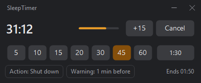

## ⬇ Download / İndir

| File / Dosya | English | Türkçe |
| --- | --- | --- |
| **SleepTimer.exe** | Just double-click, no install | Çift tıkla, kurulum yok |
| SHA256SUMS.txt | Checksum | Doğrulama özeti |

Windows 10 / 11. "Unknown publisher" → **More info → Run anyway** /
"Bilinmeyen yayımcı" → **Ek bilgi → Yine de çalıştır**.

---

## English

The first release of **SleepTimer**: a tiny, free and open-source (MIT) shutdown timer for
Windows.

- One-click times: 5, 10, 15, 20, 30, 45 and 60 minutes
- Type your own: `90`, `1:30`, `2h`, `1.5h`, `45m`
- Live countdown, end time, **+15** snooze and **Cancel**
- One-minute warning that doesn't steal focus from a fullscreen video
- Shut down, sleep or hibernate
- Keeps running in the tray when minimised
- Doesn't shut down right after waking if the time ran out while the PC was asleep
- Uses Windows' own `shutdown /s /t 0`, with nothing forced
- About 130 KB, around 20–25 MB of memory, no internet, no services
- English and Turkish, following the Windows language

## Türkçe

**SleepTimer**'ın ilk sürümü: Windows için küçük, ücretsiz ve açık kaynak (MIT) kapatma
zamanlayıcısı.

- Tek tıkla süreler: 5, 10, 15, 20, 30, 45 ve 60 dakika
- Kendi süreni yaz: `90`, `1:30`, `2s`, `1,5 sa`, `45dk`
- Canlı geri sayım, bitiş saati, **+15** erteleme ve **İptal**
- Tam ekran videonun odağını çalmayan bir dakika kala uyarısı
- Kapat, uyku ya da hazırda beklet
- Küçültünce tepside çalışmaya devam eder
- Süre bilgisayar uykudayken dolduysa uyanınca hemen kapatmaz
- Windows'un kendi `shutdown /s /t 0` komutunu kullanır, hiçbir şeyi zorlamaz
- Yaklaşık 130 KB, 20–25 MB bellek, internet yok, servis yok
- Windows diline göre Türkçe ya da İngilizce
